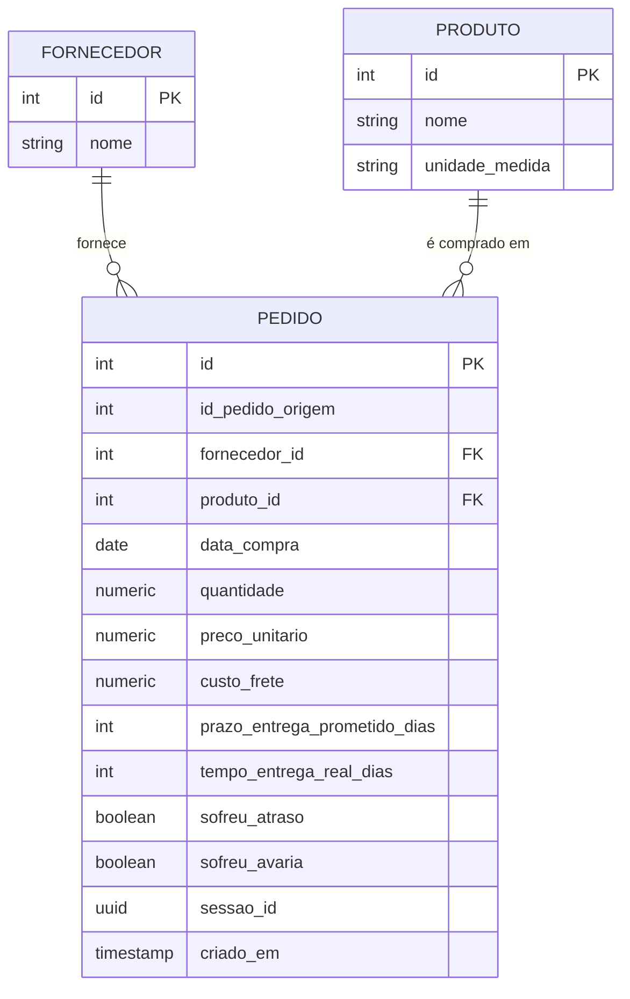
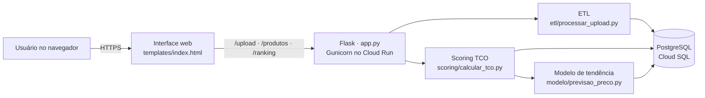
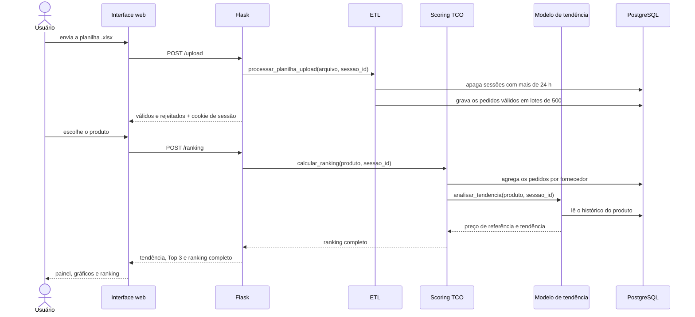
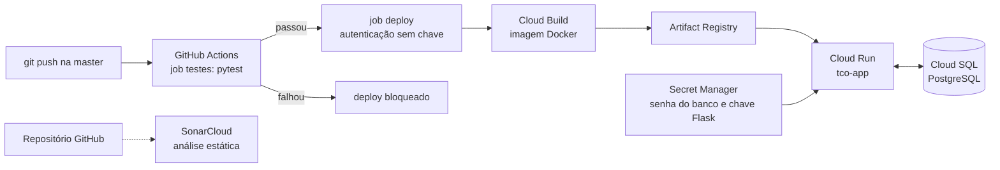
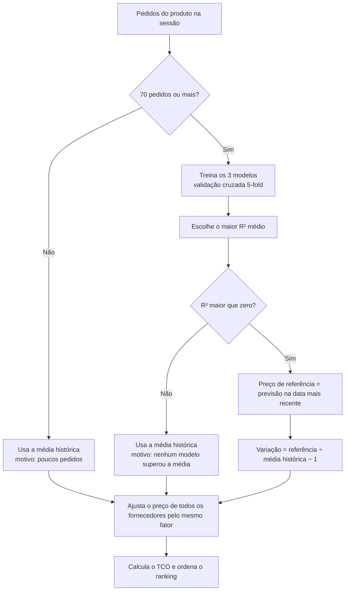
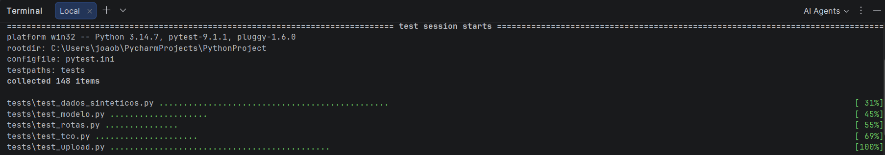
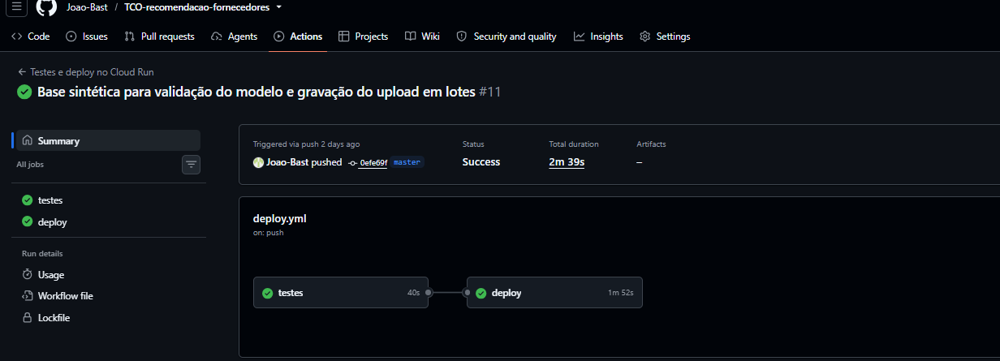
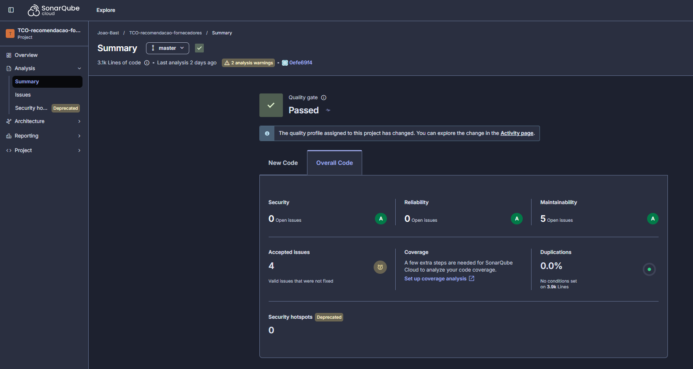
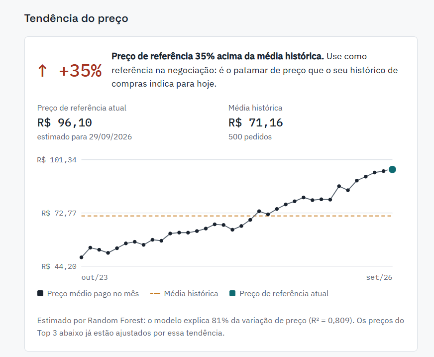
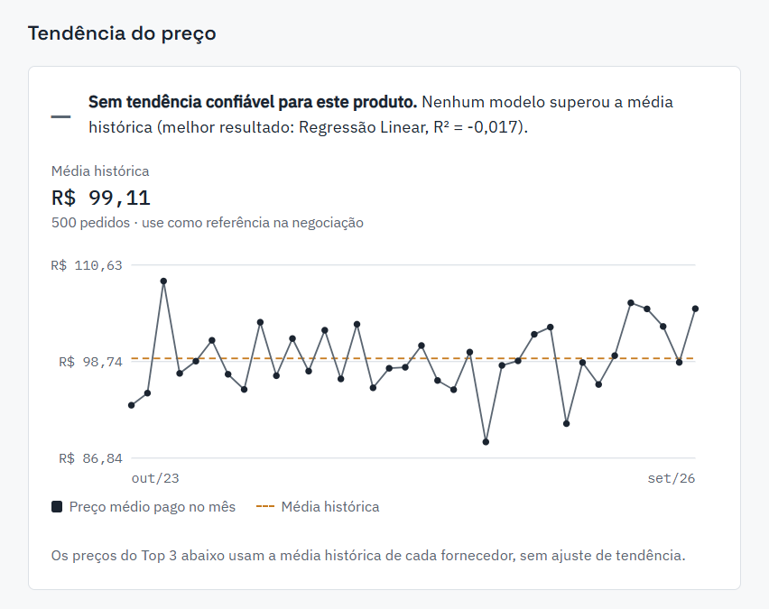

# Recomendação de Fornecedores por Custo Total (TCO)

[](https://github.com/Joao-Bast/TCO-recomendacao-fornecedores/actions/workflows/deploy.yml)

Sistema web que recomenda os melhores fornecedores para cada produto com base no **Custo Total de Aquisição (TCO)**, e não apenas no menor preço. A partir do histórico de compras enviado pelo usuário, o sistema calcula o custo real de cada fornecedor (preço, frete por unidade e o custo dos riscos de atraso e avaria) e usa **aprendizado de máquina** para estimar a tendência de preço de cada produto.

**Sistema no ar:** https://tco-app-254798258391.us-central1.run.app

Trabalho de Conclusão de Curso de Engenharia de Software, Centro Universitário Católica de Santa Catarina, Jaraguá do Sul. Autor: João Vitor da Silva Bast.

---

## Motivação do Projeto

Na área de suprimentos, a escolha de fornecedor costuma ser feita pelo menor preço unitário. Essa prática ignora custos que aparecem depois da compra: o frete, os atrasos que param a produção e as avarias que geram perda e retrabalho. O fornecedor mais barato no orçamento pode ser o mais caro na prática.

Este projeto tem três objetivos:

- **Comparar fornecedores pelo custo total**, combinando preço, frete por unidade, taxa de atraso e taxa de avaria num único valor comparável.
- **Dar ao comprador uma referência de preço para negociar**, estimando com aprendizado de máquina o patamar de preço atual de cada produto a partir do histórico.
- **Ser acessível**: qualquer empresa pode usar o sistema enviando uma planilha, sem cadastro e sem depender de plataformas corporativas caras.

---

## Documento de Proposta

A proposta do trabalho (problema de pesquisa, hipótese, objetivos e metodologia) está disponível no artigo: [Artigo do TCC](docs/Artigo_final_N3_PAC7.pdf)

---

## Dependências

### Software

- **Python 3.12**
- **Flask 3.1** (aplicação web) e **Gunicorn 26.2** (servidor em produção)
- **pandas 3.0** e **NumPy 2.5** (tratamento de dados)
- **scikit-learn 1.9** (modelos de aprendizado de máquina)
- **SQLAlchemy 2.0** e **psycopg2 2.9** (acesso ao banco)
- **openpyxl 3.1** (leitura e escrita de planilhas Excel)

Todas as versões estão fixadas em `requirements.txt`, incluindo as dependências indiretas.

### Banco de Dados

- **PostgreSQL** (local no desenvolvimento, **Google Cloud SQL** em produção).

### Testes

- **pytest 9.1** (versões fixadas em `requirements-dev.txt`).

### Infraestrutura e Qualidade

- **Docker** (imagem da aplicação)
- **Google Cloud Run** (hospedagem), **Cloud SQL** (banco) e **Secret Manager** (senhas)
- **GitHub Actions** (CI/CD: testes antes de cada deploy)
- **SonarCloud** (análise estática de código)

### Plataforma Alvo

- **Web**, acessível por qualquer navegador moderno, sem instalação.

---

## Modelagem Conceitual

| Entidade | Tipo | Responsabilidade principal | Referência |
|:--|:--|:--|:--|
| **Fornecedor** | Tabela `fornecedor` | Identifica cada fornecedor pelo nome. | `etl/processar_upload.py` |
| **Produto** | Tabela `produto` | Identifica cada produto e sua unidade de medida (KG ou LITROS). | `etl/processar_upload.py` |
| **Pedido** | Tabela `pedido` | Uma compra: data, quantidade, preço, frete, prazos, atraso, avaria e a sessão de origem. | `etl/processar_upload.py` |
| **Sessão** | Coluna `sessao_id` (UUID) + cookie | Isola os dados de cada usuário que envia uma planilha. | `app.py` |
| **Tendência do preço** | Resultado do modelo | Preço de referência atual, média histórica, variação, modelo vencedor e R². | `modelo/previsao_preco.py` |
| **Ranking de TCO** | Resultado do cálculo | TCO de cada fornecedor e sua posição para o produto escolhido. | `scoring/calcular_tco.py` |



---

## Arquitetura

### Visão Geral

A aplicação é organizada em camadas, com a interface separada da lógica de negócio:

1. **Apresentação:** página web (`templates/index.html`) em HTML, CSS e JavaScript puros, sem bibliotecas externas.
2. **Aplicação:** rotas Flask (`app.py`) que recebem as requisições e chamam os módulos de negócio.
3. **Negócio:**
   - **ETL** (`etl/processar_upload.py`): valida e grava a planilha enviada.
   - **Modelo** (`modelo/previsao_preco.py`): estima a tendência de preço de cada produto.
   - **Scoring** (`scoring/calcular_tco.py`): calcula o TCO e monta o ranking.
4. **Dados:** PostgreSQL.



### Fluxo de uma Recomendação



### Infraestrutura e Entrega Contínua



---

## Componentes Principais

### Upload e Validação (`etl/processar_upload.py`)

- Lê a planilha no formato da planilha-modelo e confere se todas as colunas obrigatórias existem.
- Valida **linha a linha** e rejeita só as linhas com problema, informando o motivo:
  - data inválida ou em branco;
  - unidade desconhecida;
  - número inválido (por exemplo, uma data no lugar do preço);
  - fornecedor ou produto vazio;
  - `ID_Pedido` duplicado.
- Aceita variações comuns digitadas pelo usuário: `L`, `Lt` e `Litro` viram LITROS; `Kg` e `Quilos` viram KG; `12,5` vira 12.5.
- O `ID_Pedido` é opcional. Quando vem vazio, o pedido é gravado sem ele.
- Grava os pedidos válidos **em lotes de 500**, numa única transação: ou entram todos, ou nenhum.
- A cada upload, apaga os dados de sessões com mais de **24 horas**.

### Modelo de Tendência do Preço (`modelo/previsao_preco.py`)

Para cada produto, o modelo aprende como o preço pago se comportou ao longo do tempo, usando os pedidos de todos os fornecedores. Ele recebe três informações de cada pedido: os dias desde a primeira compra, a quantidade comprada e o mês. Com isso, estima o preço na data da compra mais recente, para uma quantidade típica (a mediana do histórico). Esse valor é o **preço de referência atual**.

A **tendência** compara o preço de referência com a média simples de todo o histórico. Ela indica se o patamar atual de preço está acima ou abaixo do que foi praticado ao longo dos anos. Não é uma previsão do futuro: é uma estimativa do patamar atual que filtra o ruído de pedidos isolados.

Três modelos competem, avaliados por **validação cruzada de 5 partes**, e vence o de maior R² médio:

- **Regressão Linear**
- **Random Forest**
- **Gradient Boosting**



O sistema só usa a previsão quando ela supera a média histórica (R² maior que zero). Quando não supera, usa a média e informa o motivo na tela. Assim, um modelo fraco nunca contamina a recomendação.

### Cálculo do TCO (`scoring/calcular_tco.py`)

```
custo_financeiro = preço_ajustado_pela_tendência + frete_por_unidade
TCO = custo_financeiro × (1 + 0,30 × taxa_de_atraso + 0,20 × taxa_de_avaria)
```

- O frete é calculado **por unidade comprada**, e não por pedido. Assim, quem compra em lote grande não é penalizado injustamente.
- Atraso e avaria entram como penalidade proporcional sobre o custo financeiro. Os pesos (30% e 20%) ficam configuráveis no topo do arquivo.
- Fornecedores com menos de 10 pedidos aparecem com o aviso "amostra pequena".

### Rotas da Aplicação (`app.py`)

| Rota | Método | Função |
|:--|:--|:--|
| `/` | GET | Página principal |
| `/planilha-modelo` | GET | Download da planilha-modelo |
| `/upload` | POST | Recebe a planilha, valida, grava e abre a sessão |
| `/produtos` | GET | Lista os produtos da sessão |
| `/ranking` | POST | Tendência do preço, Top 3 e ranking completo |

### Interface (`templates/index.html`)

- **Painel "Tendência do preço":** variação em destaque, preço de referência atual comparado com a média histórica, o modelo vencedor e o quanto ele explica da variação de preço.
- **Gráfico do preço ao longo do tempo:** preço médio pago mês a mês, média histórica e preço de referência.
- **Gráfico do Top 3:** composição do TCO de cada fornecedor (preço, frete por unidade e risco).
- **Ranking completo:** todos os fornecedores com o respectivo TCO.
- Todo texto vindo da planilha é tratado antes de ir para a tela, o que impede que a planilha injete código na página.

---

## Sistema Genérico e Multiusuário

O sistema não foi construído para uma empresa específica. Ele funciona com o histórico de compras de qualquer empresa:

- Qualquer pessoa pode baixar a planilha-modelo, preencher com seus dados e receber recomendações, **sem cadastro**.
- Produtos e fornecedores novos entram automaticamente pela planilha, sem nenhuma mudança no código.
- Cada envio recebe uma **sessão isolada**: um usuário nunca vê os dados de outro.
- Os dados enviados são **apagados automaticamente após 24 horas**, o que reduz a retenção de dados de terceiros.
- As regras do negócio ficam em constantes no topo dos módulos e são fáceis de ajustar: pesos do TCO, mínimo de 70 pedidos, critério de confiança do modelo, tamanho do lote e tempo de retenção.

---

## Testes Automatizados

O projeto tem **148 testes automatizados** (pytest), que rodam a cada push no GitHub Actions. O deploy só acontece se todos passarem. Nenhum teste depende do banco de dados real: as consultas são substituídas por um banco falso em memória.

| Arquivo | Testes | O que cobre |
|:--|:--:|:--|
| `tests/test_upload.py` | 45 | Conversões de valores, contrato com a planilha-modelo e o fluxo completo do upload com dados problemáticos |
| `tests/test_modelo.py` | 20 | Regra dos 70 pedidos, critério de confiança (R²), reprodutibilidade, tendência e série mensal |
| `tests/test_tco.py` | 21 | Fórmula do TCO, ordenação do ranking, ajuste de tendência e campos lidos pela interface |
| `tests/test_rotas.py` | 15 | Rotas HTTP, códigos de erro e isolamento entre sessões de usuários diferentes |
| `tests/test_dados_sinteticos.py` | 47 | Validação do sistema completo com a base sintética de resultado conhecido |

Durante a escrita dos testes, foram encontrados e corrigidos dois defeitos reais: uma data em branco passava como válida, e um `ID_Pedido` em branco era enviado ao banco como `NaN`.

### Exemplo: "o mais barato não é o melhor"

O teste `test_o_mais_barato_nao_e_o_melhor` verifica a tese central do projeto em cada um dos 10 produtos da base sintética. O teste segue três etapas.

**1. Preparar.** A base sintética é gerada com perfis de fornecedor conhecidos. O Fornecedor 1 tem o menor preço, mas atrasa 60% das entregas e tem 20% de avaria.

**2. Executar.** O sistema calcula a tendência do preço e o ranking de TCO do produto, exatamente como faz em produção.

**3. Verificar.**

```python
precos = resultado["pedidos"].groupby("Nome_Fornecedor")["Preco_Unitario"].mean()
mais_barato = precos.idxmin()

assert mais_barato == "Fornecedor 1"
assert resultado["ordem_obtida"][0] != mais_barato
```

O teste confirma que o Fornecedor 1 tem de fato o menor preço médio e que, mesmo assim, ele **não fica em primeiro lugar** no ranking de TCO. Se uma alteração futura na fórmula fizesse o sistema voltar a escolher pelo menor preço, este teste falharia.



### Como Rodar os Testes

```bash
pip install -r requirements-dev.txt
pytest
```

---

## Qualidade e CI/CD

### Pipeline

A cada push na branch `master`, o GitHub Actions executa dois jobs em sequência:

1. **Testes:** instala as dependências (só pacotes pré-compilados) e roda os 148 testes com Python 3.12, a mesma versão da imagem Docker.
2. **Deploy:** roda só se os testes passarem. Ele se autentica no Google Cloud sem chave armazenada (Workload Identity Federation) e publica a nova versão no Cloud Run.

As ações do GitHub usadas no pipeline estão fixadas pelo hash do commit, e o sistema operacional do executor também está fixado (`ubuntu-24.04`).



### Análise Estática (SonarCloud)

| Critério | Nota |
|:--|:--:|
| Quality Gate | Aprovado |
| Security | A |
| Reliability | A |
| Maintainability | A |
| Duplicação | 0,0% |

Na primeira análise, o projeto tinha nota **D em Security** e **C em Reliability**. As correções incluíram:

- execução da imagem Docker sem usuário root;
- versões fixadas de todas as dependências;
- instalação só de pacotes pré-compilados;
- modo debug desligado em produção;
- rótulos de acessibilidade nos campos;
- remoção de construções confusas no JavaScript.

Quatro alertas foram **aceitos com justificativa**, porque não representam risco real neste contexto:

| Alerta | Justificativa |
|:--|:--|
| Proteção CSRF | A aplicação não tem login nem ações privilegiadas ligadas à identidade do usuário. |
| Cópia recursiva no Docker | Mitigada pelo `.dockerignore`, que exclui senhas e dados reais da imagem. |
| Dependências sem verificação por hash | Todas as versões estão fixadas. A verificação por hash fica como trabalho futuro. |
| CVE no Werkzeug (nomes de dispositivo do Windows) | Afeta só o Windows. A produção roda em contêiner Linux. |



---

## Registro de Decisões (ADR / Histórico)

- **Aprendizado de máquina por produto, e não por fornecedor:** cada fornecedor tem poucos pedidos por produto, insuficientes para treinar um modelo. O modelo aprende a tendência do produto com os pedidos de todos os fornecedores, e o TCO de cada fornecedor é calculado por estatística descritiva.
- **Frete por unidade, e não por pedido:** a comparação por pedido penalizava injustamente quem compra em lote grande. Na base real, um fornecedor passou do último para o primeiro lugar com essa correção.
- **Três modelos concorrendo:** nenhum algoritmo venceu em todos os produtos. A seleção automática por validação cruzada escolhe o mais adequado a cada padrão.
- **Validação cruzada (5-fold) em vez de uma única divisão treino/teste:** com amostras de cerca de 100 pedidos, uma única divisão dava resultados que mudavam muito conforme a divisão.
- **Critério de confiança R² > 0 e mínimo de 70 pedidos:** a previsão só é usada quando supera a média histórica e há dados suficientes. Caso contrário, o sistema usa a média e informa o motivo na tela.
- **Ordenação estável dos dados (`ORDER BY data_compra, id`):** sem o desempate, linhas com a mesma data vinham em ordem diferente a cada consulta, e o resultado do modelo mudava entre execuções.
- **PostgreSQL:** exigência da disciplina (SQLite não é permitido) e banco gerenciado disponível no Google Cloud.
- **Flask com HTML, CSS e JavaScript próprios:** separação clara entre a interface e a lógica de negócio.
- **Sessão anônima por cookie, sem login:** o uso previsto é uma consulta pontual. Os dados são isolados por sessão e apagados após 24 horas.
- **Dados reais da empresa fora do repositório:** a base real foi usada só localmente, para validar a metodologia. O repositório público contém apenas a base sintética.
- **Google Cloud Run com Docker:** a disciplina não permite plataformas como Render, Vercel e Netlify. O Cloud Run executa a imagem Docker do projeto, com o banco no Cloud SQL.
- **Senhas no Secret Manager e deploy sem chave (Workload Identity Federation):** nenhuma senha fica no código, nas variáveis em texto puro ou nos segredos do GitHub.
- **Gravação em lote no upload:** com uma linha por viagem ao banco, planilhas grandes ficavam lentas, porque o servidor e o banco estão em regiões diferentes.

---

## Resultados do Projeto

### Validação com a Base Sintética

Para validar o modelo com uma resposta conhecida, foi criada uma base sintética com 10 produtos, 10 fornecedores e 50 pedidos por fornecedor em cada produto (5.000 pedidos ao longo de 3 anos). Cada produto recebeu um padrão de preço injetado de propósito, e cada fornecedor um perfil conhecido de preço, frete, atraso e avaria.

| Item | Padrão injetado | Variação esperada | Encontrada | Modelo vencedor | R² |
|:--|:--|--:|--:|:--|--:|
| A | Alta de 25% ao ano | +35,7% | +35,0% | Random Forest | 0,81 |
| B | Alta de 10% ao ano | +14,6% | +14,2% | Regressão Linear | 0,47 |
| C | Queda de 10% ao ano | −15,0% | −14,8% | Regressão Linear | 0,48 |
| D | Queda de 20% ao ano | −28,7% | −30,9% | Regressão Linear | 0,79 |
| E | Salto de +40% nos últimos 6 meses | +32,8% | +28,2% | Random Forest | 0,67 |
| F | Queda brusca de −30% no último ano | −22,5% | −21,2% | Random Forest | 0,72 |
| G | Sazonal, sem tendência de longo prazo | −13,1% | −13,7% | Random Forest | 0,56 |
| H | Alta de 15% ao ano com sazonalidade | +12,6% | +11,4% | Gradient Boosting | 0,69 |
| I | Alta de 15% ao ano com muito ruído | +22,7% | +19,5% | Regressão Linear | 0,27 |
| J | Só ruído (controle negativo) | 0% | sem tendência confiável | — | −0,02 |

A "variação" usa a mesma medida exibida no sistema: o preço de referência atual comparado com a média de todo o histórico. Os valores foram obtidos com a semente 2026 e podem variar na casa decimal conforme a versão do scikit-learn.

**Conclusões:**

- **O modelo encontra as tendências:** o sentido saiu correto nos 9 itens com tendência, com diferença máxima de 4,6 pontos percentuais para o valor esperado.
- **O modelo não inventa tendência:** no controle negativo (Item J), o sistema recusou a previsão.
- **A seleção automática de modelo funciona:** a Regressão Linear venceu as tendências contínuas, e os modelos de árvore venceram os saltos e a sazonalidade.
- **O ML tem efeito mensurável:** no Item A, o preço atual está cerca de 36% acima da média histórica. Quem negociasse pela média subestimaria o preço atual em cerca de 26%; o modelo estimou esse patamar com erro menor que 1%.
- **O ranking de TCO reproduz o esperado:** a correlação entre o ranking obtido e o esperado ficou entre **0,87 e 0,99**. O fornecedor de menor preço não ficou em primeiro em nenhum produto, e o fornecedor com o pior perfil ficou em último em todos.





### Aplicação com a Base Real

O sistema também foi aplicado a uma base real de compras de uma empresa, com autorização. Os dados não estão publicados neste repositório.

- **Qualidade dos dados:** de 312 linhas, 303 foram aproveitadas. As 9 rejeitadas tinham 3 datas com erro de digitação, 3 datas fora do intervalo aceito e 3 IDs duplicados. A análise mostrou que os IDs em branco não eram aleatórios: eles se concentravam nos anos mais recentes (21% em 2024, 31% em 2025 e 20% em 2026). Por isso, a regra que descartava essas linhas foi revista, para não perder justamente os dados mais relevantes para a tendência.
- **Modelo:** o R² dos três produtos ficou entre **0,06 e 0,32**. O sinal de tendência nos dados reais é mais fraco do que na base sintética, porque o preço real também depende de fatores que o modelo não observa, como contratos, descontos e a troca entre fornecedores ao longo do tempo. O critério de confiança protege a recomendação nesses casos.

**Leitura conjunta:** a base sintética mostra que o método funciona quando o sinal existe; a base real mostra, com honestidade, que nos dados práticos o sinal é mais fraco e que o sistema se protege disso.

### Desempenho em Produção

- Planilha de **5.000 pedidos** processada em cerca de **15 segundos** no sistema publicado.
- Pipeline completo (148 testes e deploy) em cerca de **3 minutos**.

---

## Instruções de Uso

1. Acesse o sistema: https://tco-app-254798258391.us-central1.run.app
2. Baixe a **planilha-modelo** e preencha com o histórico de compras, um pedido por linha. A aba "Instrucoes" explica cada coluna.
3. Envie a planilha. O sistema informa quantos pedidos foram aceitos e quantos foram rejeitados.
4. Escolha um produto e clique em **Calcular recomendação**.
5. Leia o resultado:
   - **Tendência do preço:** use o preço de referência como base na negociação.
   - **Top 3:** os fornecedores de menor custo total, com a composição do custo de cada um.
   - **Ranking completo:** todos os fornecedores do produto.

Para testar sem dados próprios, use a base sintética: [`dados_sinteticos/dados_sinteticos.xlsx`](dados_sinteticos/dados_sinteticos.xlsx)

---

## Instruções de Execução (Desenvolvimento)

1. **Clone o repositório e crie o ambiente virtual:**

```bash
git clone https://github.com/Joao-Bast/TCO-recomendacao-fornecedores.git
cd TCO-recomendacao-fornecedores
python -m venv .venv
.venv\Scripts\activate          # Windows (no Linux/Mac: source .venv/bin/activate)
pip install -r requirements-dev.txt
```

2. **Crie o banco** `tcc_fornecedores` no PostgreSQL e as tabelas:

<details>
<summary>Script SQL das tabelas</summary>

```sql
CREATE TABLE fornecedor (
    id    SERIAL PRIMARY KEY,
    nome  VARCHAR(100) NOT NULL UNIQUE
);

CREATE TABLE produto (
    id              SERIAL PRIMARY KEY,
    nome            VARCHAR(100) NOT NULL UNIQUE,
    unidade_medida  VARCHAR(10) NOT NULL CHECK (unidade_medida IN ('KG', 'LITROS'))
);

CREATE TABLE pedido (
    id                            SERIAL PRIMARY KEY,
    id_pedido_origem              INTEGER,
    fornecedor_id                 INTEGER NOT NULL REFERENCES fornecedor(id),
    produto_id                    INTEGER NOT NULL REFERENCES produto(id),
    data_compra                   DATE NOT NULL,
    quantidade                    NUMERIC(10,2) NOT NULL,
    preco_unitario                NUMERIC(10,2) NOT NULL,
    custo_frete                   NUMERIC(10,2) NOT NULL,
    prazo_entrega_prometido_dias  INTEGER NOT NULL,
    tempo_entrega_real_dias       INTEGER NOT NULL,
    sofreu_atraso                 BOOLEAN NOT NULL,
    sofreu_avaria                 BOOLEAN NOT NULL,
    criado_em                     TIMESTAMP DEFAULT NOW(),
    sessao_id                     UUID NOT NULL
);

CREATE INDEX idx_pedido_produto ON pedido(produto_id);
CREATE INDEX idx_pedido_fornecedor ON pedido(fornecedor_id);
CREATE INDEX idx_pedido_sessao ON pedido(sessao_id);

-- Reservada para o histórico de recomendações (ainda não utilizada pelo sistema)
CREATE TABLE recomendacao_gerada (
    id               SERIAL PRIMARY KEY,
    produto_id       INTEGER NOT NULL REFERENCES produto(id),
    fornecedor_id    INTEGER NOT NULL REFERENCES fornecedor(id),
    posicao_ranking  INTEGER NOT NULL CHECK (posicao_ranking BETWEEN 1 AND 3),
    tco_estimado     NUMERIC(10,2) NOT NULL,
    gerado_em        TIMESTAMP DEFAULT NOW()
);
```

</details>

3. **Crie o arquivo `.env`** na raiz (ele não vai para o repositório):

```
DB_HOST=localhost
DB_PORT=5432
DB_NAME=tcc_fornecedores
DB_USER=postgres
DB_PASSWORD=sua_senha
FLASK_SECRET_KEY=um_texto_longo_e_aleatorio
FLASK_DEBUG=true
```

4. **Rode a aplicação** e acesse http://localhost:5000

```bash
python app.py
```

5. **(Opcional) Gere a base sintética:**

```bash
python scripts/gerar_dados_sinteticos.py
```

6. **(Opcional) Rode com Docker:**

```bash
docker build -t tco-app .
docker run -p 8080:8080 --env-file .env -e DB_HOST=host.docker.internal tco-app
```

---

## Trabalhos Futuros

- **Usar o fornecedor como informação do modelo**, com modelos hierárquicos que aproveitem o histórico de todos sem depender de amostras grandes por fornecedor. Isso reduziria o ruído que hoje limita o R².
- **Previsão do preço futuro** (próximos meses), além do patamar atual.
- **Histórico de recomendações**, usando a tabela `recomendacao_gerada`, já criada no banco.
- **Contas de usuário** para guardar o histórico entre sessões.
- **Verificação das dependências por hash**, completando a fixação de versões.
- **Cobertura de testes no SonarCloud**, migrando a análise para o pipeline do GitHub Actions.
- **Servidor e banco na mesma região** (São Paulo), para reduzir a latência.
- **Integração com sistemas ERP** e dados em tempo real, como previsto no artigo.